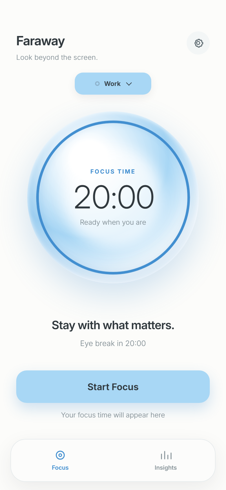
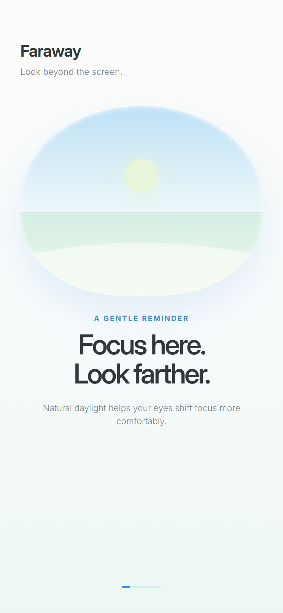
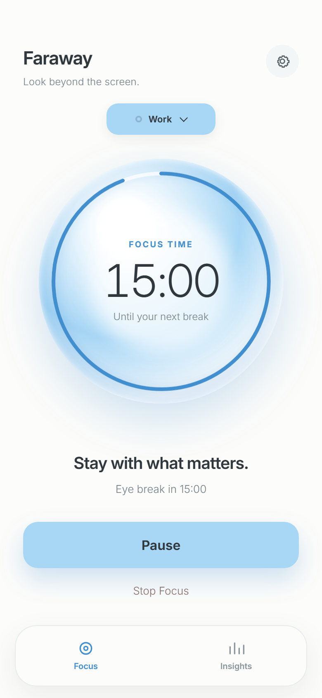
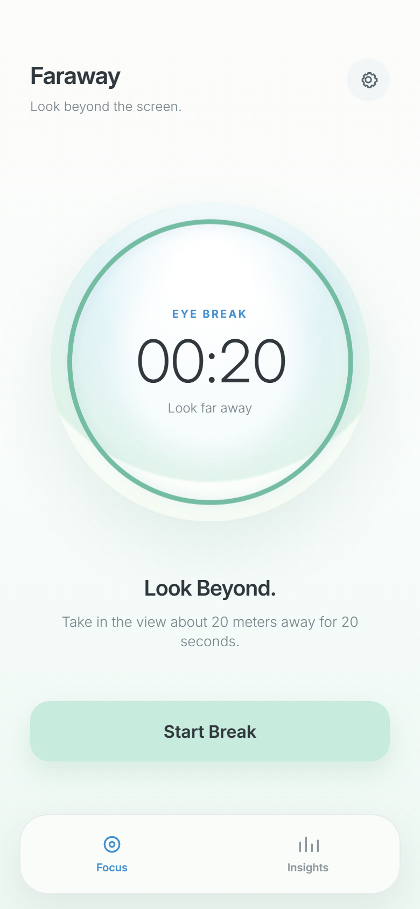
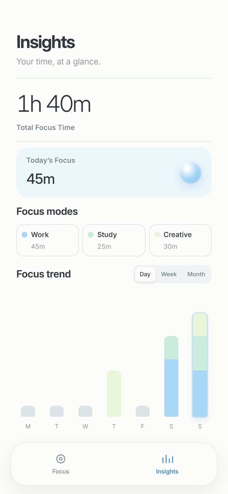
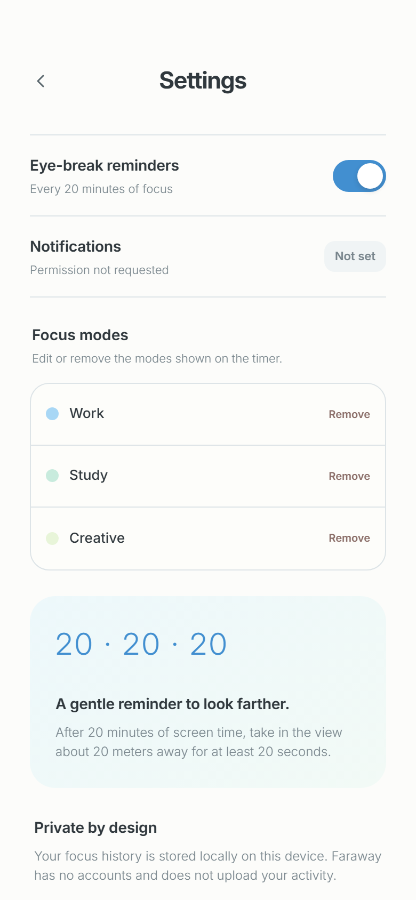
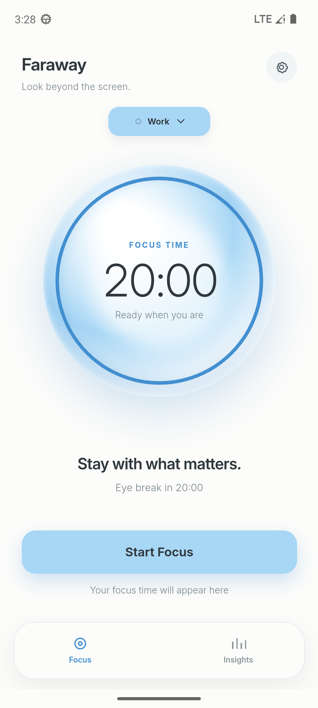
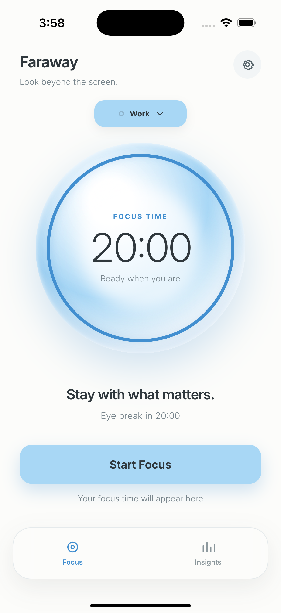

# Faraway

**Faraway** 是一个安静、离线优先的专注计时器。它把 20-20-20 护眼法则做成一段有节奏的仪式：专注 20 分钟，抬头看看约 20 米外的地方，休息 20 秒，再继续手头的事。

技术栈：Vite + React + TypeScript + Capacitor。没有账号、没有云端、没有遥测，专注记录只留在设备上。

[](https://github.com/Phanstal/Faraway/actions/workflows/ci.yml)



## 下载

从 [Releases](https://github.com/Phanstal/Faraway/releases/latest) 下载最新版本：

| 平台       | 文件                                                                                                                              | 说明                                           |
| ---------- | --------------------------------------------------------------------------------------------------------------------------------- | ---------------------------------------------- |
| Android    | [`Faraway-0.1.3-android-debug.apk`](https://github.com/Phanstal/Faraway/releases/latest/download/Faraway-0.1.3-android-debug.apk) | 可直接安装的 debug 签名 APK                    |
| iOS        | [`Faraway-0.1.3-ios-unsigned.ipa`](https://github.com/Phanstal/Faraway/releases/latest/download/Faraway-0.1.3-ios-unsigned.ipa)   | 未签名 IPA，需要使用自己的 Apple ID 重签后安装 |
| iOS 模拟器 | [`Faraway-0.1.3-ios-simulator.zip`](https://github.com/Phanstal/Faraway/releases/latest/download/Faraway-0.1.3-ios-simulator.zip) | 需要 macOS + Xcode，解压后拖入模拟器           |
| 校验       | [`SHA256SUMS.txt`](https://github.com/Phanstal/Faraway/releases/latest/download/SHA256SUMS.txt)                                   | 所有发布文件的 SHA-256                         |

### Android 安装

1. 下载 APK 到手机。
2. 在系统设置中允许当前文件管理器或浏览器「安装未知应用」。
3. 打开 APK 完成安装；首次启动会进入欢迎页，然后自动进入专注计时器。
4. 如果系统提示「Play 保护机制」拦截，选择「仍要安装」。这是 debug 签名的正常提示，不是恶意软件。

> APK 使用 Android debug key 签名，适合个人安装与验收，不适合直接提交 Google Play。正式上架需要配置 release keystore 后重新签名。

### iOS 安装

仓库中没有 Apple Developer 证书，因此无法提供可直接双击安装的签名 IPA。当前提供：

- **未签名 IPA**：用 Sideloadly、AltStore 等工具，配合自己的 Apple ID 重签后安装到 iPhone；免费 Apple ID 的签名通常 7 天过期。
- **模拟器 zip**：在 macOS 上解压，打开 Xcode Simulator，把 `App.app` 拖入模拟器窗口即可运行。

如果要在真机上完整验收，推荐在 Mac 上打开 `ios/App/App.xcworkspace`，在 Signing & Capabilities 中选择自己的 Team，然后 Run 到 iPhone。详细步骤见 [真机验收清单](docs/ACCEPTANCE.md)。

## 功能

- **专注计时**：默认 20 分钟专注，环形进度和剩余时间同时呈现；可随时暂停、继续。
- **模式下拉**：计时器上方以紧凑下拉切换 Work / Study / Creative，专注进行中也可以直接换模式，配色会同步变化。
- **20 秒眼休息**：专注结束后进入 `EYE BREAK`，提示看向约 20 米外；主按钮变为 `Start Break`，也可以跳过休息或直接开始下一轮。
- **停止本轮**：专注中或暂停时可点 `Stop Focus`，经过两步确认后结束本轮；已专注满 1 分钟会按整分钟写入历史。
- **专注洞察**：总时长、今日时长、按模式拆分，以及 Day / Week / Month 三种趋势视图；趋势柱按模式颜色堆叠，空状态会引导完成第一轮专注。
- **模式管理**：设置中可改名、删除，最多保留 3 个、至少保留 1 个；删除当前模式后会自动切换。
- **重置数据**：设置页提供 `Reset Faraway`，经过两步确认后清空本机历史、模式与偏好。
- **原生提醒**：Android / iOS 在专注结束前请求通知权限，并在计时结束时发出本地通知；设置中可关闭提醒。
- **原生手感**：开始、暂停、完成和进入休息时有轻微触感反馈；Android 返回键按「设置/洞察 → 专注」逐层返回，专注页返回则退到后台。
- **本地持久化**：Android 使用 SharedPreferences，iOS 使用 UserDefaults，Web 使用 localStorage；刷新、杀进程或重启应用后，计时状态和记录仍在。
- **安全区适配**：适配 iPhone 刘海/灵动岛、Home Indicator 和 Android 状态栏/手势条，并锁定竖屏。







Android 原生运行（API 33 模拟器，1080 × 2400）：



iOS 模拟器运行（GitHub Actions macOS 14，iPhone 15 Pro）：



## 隐私

- 不创建账号，不连接服务器，不发送分析或崩溃数据。
- 专注记录只写入当前设备的应用私有存储。
- 卸载应用或在系统设置中清除应用数据会删除记录；当前版本没有导出/导入功能。

## 已知限制

- 后台本地通知依赖 Android 闹钟调度。未授予「闹钟和提醒」权限时，系统会使用非精确闹钟，通知可能延迟约 1 分钟；应用内计时不受影响。
- 当前没有云同步、账号、导出/导入，数据只在本机。
- Android APK 使用 debug 签名，适合个人安装验收，不适合直接上架 Google Play。
- iOS 只提供未签名 IPA 和模拟器包，真机需要自行签名。

## 设计来源与实现差异

界面依据提供的 [Figma Make 原型](https://www.figma.com/make/mup9OJMdY4TlgWJ7mDLIFF/Faraway-iOS-App-Design) 复刻，保留了原型的浅蓝、冰蓝、薄荷绿配色，Inter 字体，圆形计时器，计时器上方的模式下拉，底部双标签，以及欢迎页、专注、眼休息、完成、洞察和设置六个界面。0.1.3 按原型当前版本重做了专注页、模式切换、停止确认、重置数据和洞察堆叠柱状图。

原型为了演示把专注时长加速成 **10 秒**，截图中的计时器显示 `00:10`。正式版按 20-20-20 法则恢复为 **20 分钟**，眼休息保持 **20 秒**，因此专注页初始显示 `20:00`。这是唯一有意的行为调整，其余文案、层级与交互节奏按原型实现。

## 开发

### 环境

- Node.js 22 或更高版本
- npm 10 或更高版本
- Android：JDK 17、Android SDK 34
- iOS：macOS、Xcode 15+、CocoaPods

### Web

```bash
npm ci
npm run dev
```

打开终端输出的地址。Web 端使用 localStorage，适合快速查看交互与视觉。

### 检查

```bash
npm run lint
npm run format:check
npm run typecheck
npm test
npm run build
```

### 移动端 E2E

Playwright 使用 Pixel 7 / Chromium 移动端模拟：

```bash
npx playwright install chromium
npm run test:e2e
```

Windows 本机如果不想下载 Playwright 浏览器，可使用已安装的 Edge：

```powershell
$env:PLAYWRIGHT_CHANNEL = 'msedge'
npm run test:e2e
```

### Android

```bash
npm run build
npx cap sync android
cd android
./gradlew assembleDebug
```

APK 输出：`android/app/build/outputs/apk/debug/app-debug.apk`。

Windows 上如果 Gradle 使用到旧版 Java，请先设置：

```powershell
$env:JAVA_HOME = 'C:\Program Files\Android\Android Studio\jbr'
$env:Path = "$env:JAVA_HOME\bin;$env:Path"
```

### iOS

```bash
npm run build
npx cap sync ios
cd ios/App
pod install
open App.xcworkspace
```

在 Xcode 中选择自己的 Team 并 Run。CI 会在 macOS runner 上构建模拟器 App 和未签名设备 IPA。

## 测试

- `tests/unit`：计时格式、时长统计、本地日界线、图表聚合与模式分段、快照迁移、暂停/恢复、停止本轮、会话去重。
- `tests/e2e`：欢迎页、完整 20-20-20 流程、暂停/恢复、模式下拉、停止本轮、重置数据、设置中的模式增删改、从完成态开始下一轮、刷新持久化。
- CI 同时验证 Web 检查、Android debug APK 构建、iOS 模拟器构建与启动截图。

## 目录

```text
src/
  app/                应用壳、页面切换与 Android 返回键
  components/         计时器、标签栏、图标、各页面
  domain/             常量、时间计算、快照归一化与恢复
  features/           计时器状态编排与持久化 hook
  infra/              Capacitor Preferences 仓库
  platform/           触感与本地通知
  styles.css          全局样式与移动端安全区适配
tests/
  unit/               Vitest
  e2e/                Playwright
android/              Capacitor Android 工程
ios/                  Capacitor iOS 工程
docs/                 发布说明、验收清单、截图
```

## License

个人项目，未附带开源许可证；如需复用代码或设计，请先联系作者。
