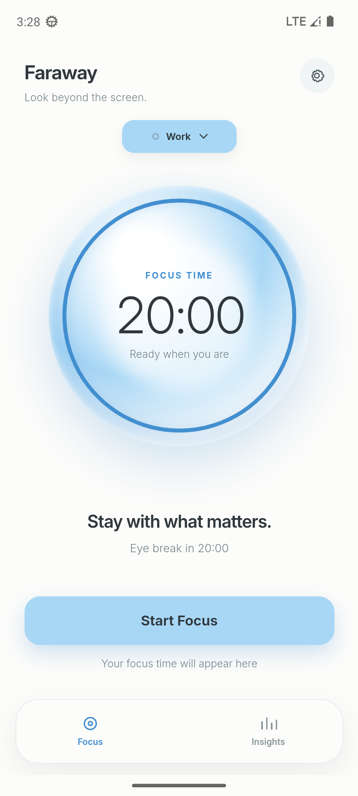
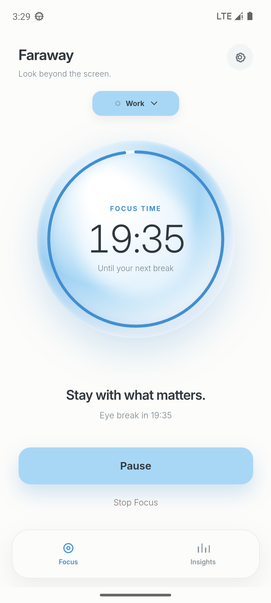
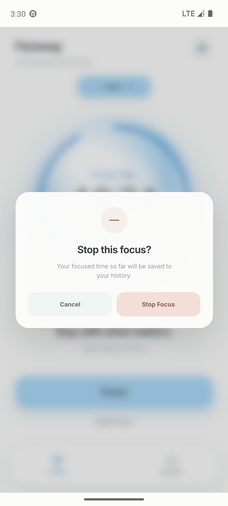
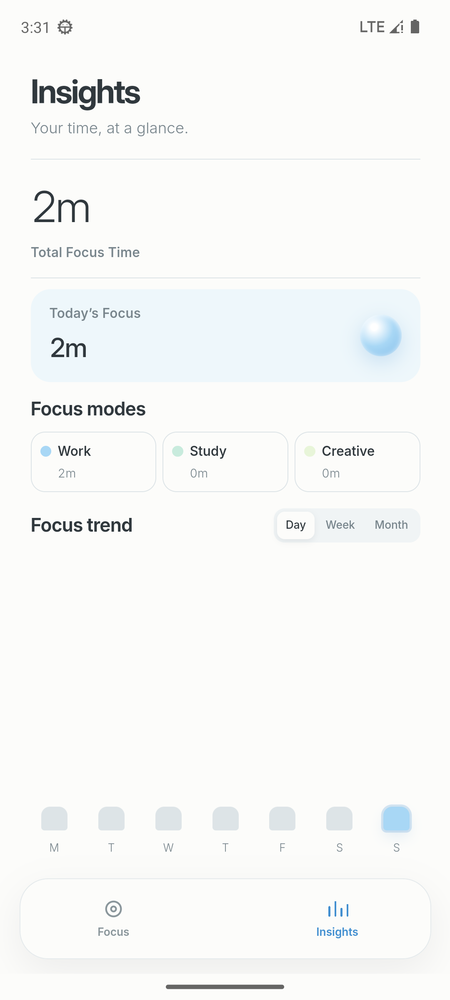
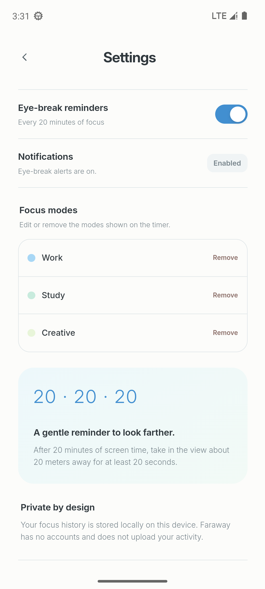
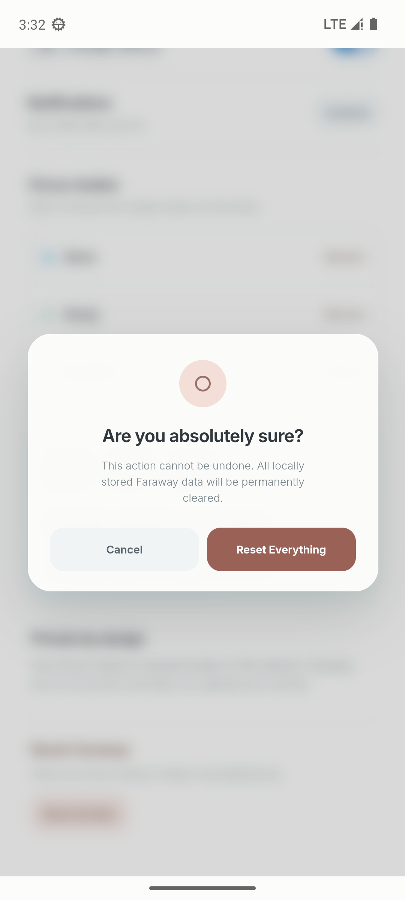
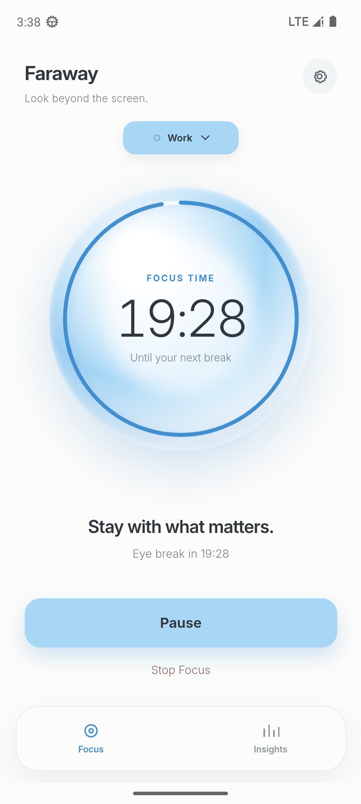
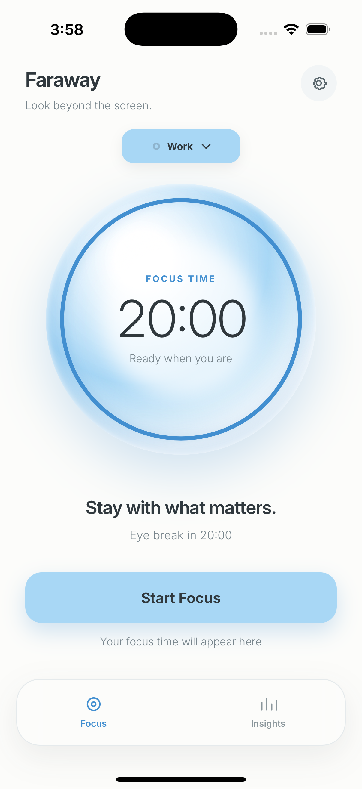

# Faraway 真机验收清单

## 验收范围

本清单覆盖 Android、iOS 和 Web 三个运行面。Android 已在本地 API 33 模拟器完成 0.1.3 的界面与关键交互验收；iOS 模拟器由 GitHub Actions 的 macOS 14 runner 构建、安装并启动，但本地没有 Mac，因此真机安装与运行仍需在 iPhone 或 Mac 上补充验证。

验收目标不是只看「能打开」，而是同时确认：

1. 视觉与交互是否忠实于 Figma 原型当前版本；
2. 20 分钟专注、20 秒眼休息和 5 秒欢迎页的节奏是否正确；
3. 模式下拉、停止确认、重置数据等新交互是否可用；
4. 本地数据在重启、杀进程、切后台后是否仍在；
5. 通知权限、触感、安全区、竖屏和 Android 返回键是否正常；
6. 发布产物是否与实际代码一致。

## 验收环境

| 项目     | 本地验收                                            | 发布验证                                            |
| -------- | --------------------------------------------------- | --------------------------------------------------- |
| Android  | Android 13 / API 33 x86_64 模拟器，1080 × 2400      | GitHub Actions Ubuntu + JDK 17 + Android SDK 34     |
| iOS      | 未在本地运行（Windows 无 Xcode）                    | GitHub Actions macOS 14：模拟器构建、启动与截图通过 |
| Web      | Microsoft Edge / Chromium，390 × 844 与 1440 × 1000 | GitHub Actions Chromium 移动端 E2E                  |
| 应用版本 | 0.1.3（versionCode 4 / build 4）                    | 同左                                                |
| 日期     | 2026-11-01                                          | 以 release workflow 实际运行日期为准                |

## Android 验收步骤

安装 debug APK 后，按顺序执行。

### A1 冷启动与欢迎页

- 清除应用数据后启动，应出现浅色启动画面与 Faraway 图标。
- 欢迎页依次显示 `Faraway`、`Look beyond the screen.`、天空/地平线视觉、`A GENTLE REMINDER`、`Focus here. Look farther.` 与一条随机护眼提示。
- 底部进度条在 5 秒内从 0 走到满，然后自动进入专注页。
- 点按欢迎页可以立即进入专注页。

### A2 专注页初始状态

- 顶部显示 `Faraway`、`Look beyond the screen.` 和设置图标。
- 计时器为 `FOCUS TIME`、`20:00`、`Ready when you are`，环形进度完整。
- 计时器上方显示当前模式 `Work` 胶囊，右侧有下拉箭头；点击后出现 Study / Creative 选项。
- 下方显示 `Stay with what matters.`、`Eye break in 20:00`、`Start Focus` 和 `Your focus time will appear here`。
- 底部为 Focus / Insights 双标签。

### A3 通知权限

- 首次点 `Start Focus` 时，系统弹出 `Allow Faraway to send you notifications?`。
- 选 `Allow` 后计时开始；`adb logcat` 中能看到 `LocalNotifications.schedule`，通知 id 为 `4101`，触发时间为 20 分钟后。
- 在设置中关闭 `Eye-break reminders` 后，`adb logcat` 中能看到 `LocalNotifications.cancel`。
- 设置中的 Notifications 状态应显示 `Enabled`、`Denied` 或 `Not set`，与系统权限一致。

### A4 开始、暂停与恢复

- 点 `Start Focus` 后计时从 `20:00` 开始递减，按钮变为 `Pause`。
- 点 `Pause` 后计时冻结，主按钮变为 `Resume`，环形下方显示 `PAUSED` 与 `Your focus time is paused.`。
- 点 `Resume` 后从冻结处继续，不会重置为 20:00。
- 按 Home 退到后台，等待 20 秒以上再回到应用，剩余时间应按真实时间减少。
- 专注中模式下拉仍可见，切换模式后配色和当前模式文案同步变化。

### A5 停止本轮

- 专注中或暂停时，主按钮下方显示 `Stop Focus`。
- 点击后出现 `Stop this focus?` 对话框；已满 1 分钟时说明文字为 `Your focused time so far will be saved to your history.`。
- 点 `Cancel` 关闭对话框并继续计时；点 `Stop Focus` 结束本轮，回到 `Start Focus` / `20:00`。
- 切到 Insights，刚结束的轮次应按整分钟出现在总计、今日与对应模式中；不足 1 分钟的轮次不产生记录。

### A6 完整 20-20-20 循环

- 专注计时到 `00:00` 后自动进入 `EYE BREAK` / `Look Beyond.`，显示 `Start Break`。
- 点 `Start Break` 后开始 20 秒倒计时；点 `Skip break` 会直接进入完成页。
- 休息倒计时结束后进入 `COMPLETE`、`00:00`、`Lovely. You're ready to continue.` 与 `Resume Focus`。
- 点 `Resume Focus` 应直接开始下一轮 20:00 专注。
- 通知应在专注结束时出现，标题为 `Time to look far away`。如果系统未授予「闹钟和提醒」权限，Android 会使用非精确闹钟，通知可能延迟约 1 分钟；应用内计时不受影响。

### A7 专注洞察

- 完成一轮后切到 Insights，`Total Focus Time` 与 `Today's Focus` 均增加 20m。
- 对应模式的紧凑卡片行增加 20m；Day 趋势图当天出现一根高柱。
- 趋势柱按模式颜色堆叠：Work 蓝色、Study 薄荷绿、Creative 浅绿；悬停/滚动时图例不遮挡标签。
- Day / Week / Month 切换后图表、堆叠段与标签随之变化。
- 没有记录时显示 `Your focus journey starts here.` 与说明文字，不显示空图表。

### A8 设置、模式管理与重置

- 点右上角设置，标题为 `Settings`，返回按钮、提醒开关、通知状态、模式列表、20-20-20 说明、隐私说明和 `Reset Faraway` 均可见。
- 点模式名可直接编辑，失焦后保存；清空时回退为 `Focus`。
- 删除模式：至少保留 1 个；删除当前模式后，计时页应切换到剩余的第一个模式。
- 新增模式：最多 3 个；输入名称后点 Add 或按回车；达到 3 个后不再显示加号入口。
- 退出设置后，专注页的模式下拉与配色应同步更新。
- 点 `Reset all data`，第一次确认显示 `Reset Faraway?`，点 `Continue` 后显示 `Are you absolutely sure?`；点 `Reset Everything` 后清空数据并回到专注页，Insights 归零。
- 重置过程中点 `Cancel` 应关闭对话框，不修改数据。

### A9 Android 返回键

依次验证：

1. 设置页按返回 → 回到专注页。
2. 洞察页按返回 → 回到专注页。
3. 专注页按返回 → 应用退到后台，不崩溃。
4. 在欢迎页按返回 → 进入专注页。

### A10 重启持久化

- 开始一轮专注，等待几秒后杀进程或冷启动应用。
- 欢迎页结束后，专注页应恢复计时，剩余时间按真实流逝时间计算，而不是重置。
- `adb shell run-as com.phanstal.faraway cat shared_prefs/CapacitorStorage.xml` 中能看到 `faraway.snapshot.v1`。
- 已完成会话在 Insights 中仍然存在。

### A11 竖屏与安全区

- 旋转设备不应变成横屏。
- 顶部内容不压状态栏；底部标签栏不被手势条遮挡。
- 设置页内容较长时可以滚动，最后一项重置区域可完整看到。

## iOS 验收步骤

本地没有 Mac，以下需要在 macOS 或真机上完成。

### I1 模拟器运行

- 下载 `Faraway-0.1.3-ios-simulator.zip`，解压得到 `App.app`。
- 打开 Xcode Simulator，把 `App.app` 拖入模拟器；或从源码运行：

```bash
npm run build
npx cap sync ios
cd ios/App
pod install
open App.xcworkspace
```

- 选择任意 iPhone 模拟器 Run。
- 检查：欢迎页 5 秒自动进入专注；顶部不压灵动岛/刘海；底部标签栏不压 Home Indicator；设置可滚动；竖屏锁定。
- 检查通知：首次 Start Focus 弹出系统权限；允许后 20 分钟本地通知已排期。
- 检查完整循环、暂停/恢复、模式下拉、停止确认、重置数据与洞察堆叠柱，表现应与 Android 一致。

### I2 真机安装（需要签名）

- 在 Xcode 打开 `ios/App/App.xcworkspace`。
- 选择 App target → Signing & Capabilities，选择自己的 Team，修改唯一 Bundle Identifier。
- 连接 iPhone，选择设备 Run。
- 或者用 Sideloadly / AltStore 重签 `Faraway-0.1.3-ios-unsigned.ipa`。
- 检查启动图、状态栏、安全区、触感反馈、本地持久化与通知。
- 杀进程后重新打开，数据仍在。

### I3 iOS 限制说明

- 未签名 IPA 不能直接安装；这是 Apple 平台签名机制决定的，不是构建失败。
- 免费 Apple ID 签名通常 7 天过期，需要重新签名。
- 正式分发需要 Apple Developer Program 账号、证书与描述文件。

## Web 验收步骤

- `npm run build && npm run preview`，打开 `http://127.0.0.1:4785`。
- 检查桌面宽度下是否居中显示手机画布；移动端浏览器全屏显示。
- 浏览器刷新后数据仍在 localStorage。
- 清除站点数据后回到欢迎页和空洞察。
- Web 端通知依赖浏览器 Notification API；部分浏览器会静默拒绝，状态显示 `Denied` 或 `Unavailable`，不影响计时。

## 原生实测记录

2026-11-01 在 Android 13 / API 33 模拟器上完成 0.1.3 验收：

- 全新安装 `versionCode 4` / `versionName 0.1.3`，首次 `Start Focus` 弹出通知权限；允许后计时正常递减。
- 运行约 2 分钟后点 `Stop Focus`，确认对话框出现；确认后回到 `20:00`，Insights 记录 2m。
- 设置页显示通知 `Enabled`；`Reset Faraway` 两次确认后回到专注页，Insights 归零。
- 专注后杀进程再启动，恢复为 `19:28`，说明计时状态与会话都已落盘。
- 欢迎页、专注页、洞察页、设置页在 1080 × 2400 下安全区正常；页面可滚动。
- 返回键层级与 0.1.2 一致：设置/洞察 → 专注 → 桌面；欢迎页返回 → 专注页。









iOS 模拟器由 CI 启动并截图，界面与安全区正常：



## 自动化证据

| 检查        | 命令                      | 结果                   |
| ----------- | ------------------------- | ---------------------- |
| 单元测试    | `npm test`                | 19 passed              |
| 移动端 E2E  | `npm run test:e2e`        | 7 passed               |
| 类型        | `npm run typecheck`       | passed                 |
| Lint        | `npm run lint`            | passed                 |
| 格式        | `npm run format:check`    | passed                 |
| Android APK | `./gradlew assembleDebug` | BUILD SUCCESSFUL       |
| iOS 模拟器  | GitHub Actions macOS      | 构建、启动、截图均成功 |
| CI 全流程   | GitHub Actions            | [CI_RUN_LINK]          |

## 发布产物验收

- [ ] GitHub Release 包含 APK、未签名 IPA、模拟器 zip、SHA256SUMS.txt。
- [ ] 所有文件的 SHA-256 与 `SHA256SUMS.txt` 一致。
- [x] APK 安装到 Android 13 模拟器并成功启动；包内版本为 `0.1.3` / `4`，初始计时器显示 `20:00`。
- [ ] 未签名 IPA 能被重签工具识别（不要求直接安装；当前只验证了 Payload/App.app 结构完整）。
- [ ] 模拟器 zip 能在 macOS Xcode Simulator 中启动（CI 已对同源 Debug 模拟器包做启动截图，Release zip 未单独启动）。
- [ ] 真机验收记录补充到本文件。

## 发布记录

- Release：[Faraway v0.1.3](https://github.com/Phanstal/Faraway/releases/tag/v0.1.3)（[RELEASE_RUN_LINK]）
- CI：[CI_RUN_LINK]
- 本地 Android 验收：API 33 模拟器，`0.1.3` APK 安装成功；模式下拉、停止确认、重置、持久化与安全区已验证。
- iOS：模拟器构建与启动截图通过；真机安装需要用户自己的 Apple 签名，未在本机验证。
